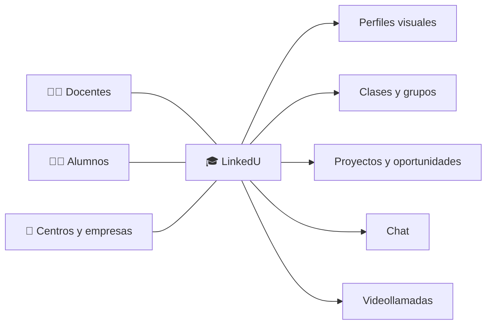

# 🎓 LinkedU

> **Conecta. Aprende. Enseña.**  
> Una red educativa para encontrar docentes, alumnos, grupos de estudio y oportunidades.

## 🌍 ¿Qué es LinkedU?

LinkedU conecta a **docentes**, **alumnos** y **centros o empresas educativas** en un mismo espacio. La idea es que encontrar a la persona adecuada y empezar a colaborar sea fácil, visual y directo, sin currículums interminables.



## ✨ ¿Qué puedes hacer?

| 👤 Crear tu perfil | 🔎 Encontrar personas | 📚 Aprender en grupo | 🤝 Colaborar |
|---|---|---|---|
| Bio corta, idiomas e intereses | Filtrar por materia, ubicación y modalidad | Conectar con docentes y grupos de estudio | Publicar proyectos y oportunidades |

El contacto empieza en el **chat**. Para dar clases y reunirse, los usuarios pueden reservar una **videollamada dentro de LinkedU**. Los perfiles se centran en lo importante: quién eres, qué sabes y qué estás buscando.

## 💸 Una monetización sencilla

El chat y los perfiles pueden ser gratuitos. LinkedU gana dinero cuando ofrece un servicio útil y concreto: **reservar, pagar y realizar clases o reuniones por videollamada dentro de la plataforma**.

### 1. Clases individuales

El docente fija el precio y la duración de la clase. El alumno reserva y paga desde LinkedU, y la plataforma retiene una **comisión pequeña** a cambio de facilitar la reserva, el pago y la sala de vídeo.

**Ejemplo orientativo:** con una comisión del **8 %**, una clase de 20 € deja 1,60 € para LinkedU y 18,40 € para el docente, antes de costes de pago e impuestos.

### 2. Clases grupales y grupos de estudio

El docente puede cobrar por la clase y cada alumno paga su parte al reservar. Como alternativa para grupos de estudio sin docente, se puede probar una tarifa de **2 € por alumno y por hora** por usar la sala de videollamada.

**Ejemplo:** 4 alumnos × 2 € = **8 € por hora** por la sala. Si hay un docente, su precio debe mostrarse aparte para que quede claro qué se paga por la clase y qué por usar la plataforma.

> **Regla importante:** no cobrar a la vez la tarifa de sala y la comisión por clase en una misma reserva sin explicarlo y validarlo. Antes de pagar, cada participante debe ver el precio total y cómo se reparte.

### 3. Contrataciones de centros

Si LinkedU facilita una contratación y el pago se gestiona en la plataforma, se puede valorar una comisión acordada. Si el contacto y el contrato ocurren fuera de LinkedU, es difícil verificar la operación: no conviene contar esa comisión como ingreso seguro.

### 🧪 Probar antes de fijar el precio

El **8 %** y los **2 € por alumno y hora** son ideas para validar, no tarifas definitivas. Hay que tener en cuenta el coste del proveedor de vídeo, los pagos y el soporte. Mostrar siempre el precio completo antes de reservar y definir qué ocurre ante cancelaciones o problemas técnicos.

## 🧭 La experiencia que buscamos

- Perfiles rápidos, visuales y fáciles de entender.
- Búsqueda por ubicación, modalidad, idiomas y especialidad.
- Chat directo gratuito para conocerse y coordinarse.
- Videollamadas integradas para impartir clases y organizar sesiones grupales.
- Proyectos colaborativos con estados: **buscando colaboradores**, **en curso** y **finalizado**.
- Sin CVs extensos ni biblioteca de archivos.

## 🧩 Tecnología

**Vite + JavaScript** · **Supabase Auth/PostgreSQL/Realtime/Edge Functions** · **Stripe Connect** · **LiveKit**

## 🔐 Funcionalidad integrada

- Registro, inicio y cierre de sesión; perfiles con especialidad, idiomas, precio y horario semanal (hora de Madrid).
- Foto de perfil o logo de centro mediante carga de imágenes (JPG, PNG o WebP; máximo 5 MB).
- Búsqueda de perfiles públicos y chat privado en tiempo real.
- Envío de imágenes en el chat (JPG, PNG o WebP; máximo 8 MB), guardadas en un bucket privado y accesibles solo para los miembros de la conversación.
- Reserva de una hora. El servidor comprueba disponibilidad y bloquea solapamientos, cobra mediante Stripe Checkout y envía el **92 %** al docente conectado; LinkedU retiene el **8 %** del precio de la clase.
- Salas de estudio de 1–3 horas: **2 € por participante y hora**, pagados por Stripe Checkout.
- Promoción opcional para docentes: **24,99 € por 15 días hábiles**, pagada una sola vez. Los días hábiles cuentan de lunes a viernes y no excluyen festivos.
- Videollamadas LiveKit para participantes con reserva o plaza pagada confirmada; se emiten tokens temporales y restringidos a la sala.
- Cancelación con reembolso completo hasta 24 horas antes; la devolución puede tardar según el banco.

## 🚀 Configuración

### 1. Supabase y base de datos

1. Crea un proyecto Supabase y abre **SQL Editor**.
2. Ejecuta en este orden [`supabase-schema.sql`](./supabase-schema.sql) y [`supabase-marketplace.sql`](./supabase-marketplace.sql). Si ya ejecutaste antes el SQL de marketplace, vuelve a ejecutar el archivo actualizado para crear los buckets de imágenes, permisos y columnas de mensajes adjuntos.
3. En **Authentication → URL Configuration**, permite `http://localhost:5173/**` y, al publicar, tu dominio HTTPS.
4. Copia `.env.example` a `.env.local` con `Copy-Item .env.example .env.local` en PowerShell. Configura la URL y la clave pública (`publishable`/`anon`). **Nunca pongas `service_role`, claves de Stripe ni secretos LiveKit en variables `VITE_*` o en el navegador.**

### 2. Stripe, pagos de prueba

1. Crea una cuenta Stripe y usa primero **test mode**. Los docentes completarán el alta de Stripe Connect Express desde su perfil.
2. En los secretos de las Edge Functions de Supabase configura `APP_URL`, `STRIPE_SECRET_KEY` de prueba (`sk_test_...`) y `STRIPE_WEBHOOK_SECRET`. Supabase proporciona sus secretos de servidor a las funciones; si tu proyecto no los incluye, configura `SUPABASE_URL`, `SUPABASE_ANON_KEY` y `SUPABASE_SERVICE_ROLE_KEY` solo como secretos del servidor. Las claves `sk_live_...` se rechazan salvo que habilites explícitamente `ENABLE_LIVE_PAYMENTS=true`.
3. En una terminal, instala e inicia sesión en Supabase CLI y vincula tu proyecto (`supabase link --project-ref <project-ref>`). Después despliega las funciones:

   ```powershell
   supabase functions deploy connect-teacher
   supabase functions deploy create-booking-checkout
   supabase functions deploy create-study-room-checkout
   supabase functions deploy join-study-room-checkout
   supabase functions deploy cancel-paid-session
   supabase functions deploy create-teacher-promotion-checkout
   supabase functions deploy create-video-token
   supabase functions deploy stripe-webhook --no-verify-jwt
   ```

   En **Supabase → Edge Functions → Secrets**, añade las credenciales de servidor. No las pongas en archivos de frontend, las compartas en chat ni las subas al repositorio. La función webhook desactiva JWT porque valida la firma propia de Stripe.
4. Crea en Stripe un webhook para `https://<project-ref>.supabase.co/functions/v1/stripe-webhook` y configura los eventos `account.updated`, `checkout.session.completed`, `checkout.session.expired`, `checkout.session.async_payment_failed`, `checkout.session.async_payment_succeeded` y `charge.refunded`. Guarda el secreto de firma del webhook en Supabase. La promoción solo se activa cuando el webhook de Stripe confirma el pago.

La compra de promoción aparece en el perfil guardado como docente. Para poder comprarla, el perfil debe estar publicado y tener una materia. Los docentes destacados se muestran primero mientras la promoción está activa; los pagos no se renuevan automáticamente.

### 3. LiveKit y arranque

1. Crea un proyecto LiveKit Cloud y guarda `LIVEKIT_URL`, `LIVEKIT_API_KEY` y `LIVEKIT_API_SECRET` como secretos de las Edge Functions de Supabase.
2. En la terminal: `npm install` y `npm run dev`.
3. Abre la dirección de Vite. Las claves de Stripe y LiveKit se usan únicamente en el servidor.

Sin configurar y desplegar estos servicios, LinkedU mantiene el catálogo de ejemplo; cuentas, chat, reservas, pagos y vídeo requieren los servicios. Nunca uses claves de Stripe en modo live hasta probar pagos, webhooks, reembolsos, Connect y políticas de cancelación.

> **Antes de cobrar de verdad:** revisa las condiciones de uso, obligaciones fiscales y de consumo, protección de datos, cuentas de menores, soporte y política de cancelación con asesoramiento profesional. El plazo de 24 horas es una configuración inicial, no una revisión legal. Stripe y LiveKit pueden cobrar sus propias tarifas.

## 🚀 En una frase

**LinkedU conecta a la comunidad educativa y ofrece un espacio propio para reservar y realizar clases y reuniones online.**
